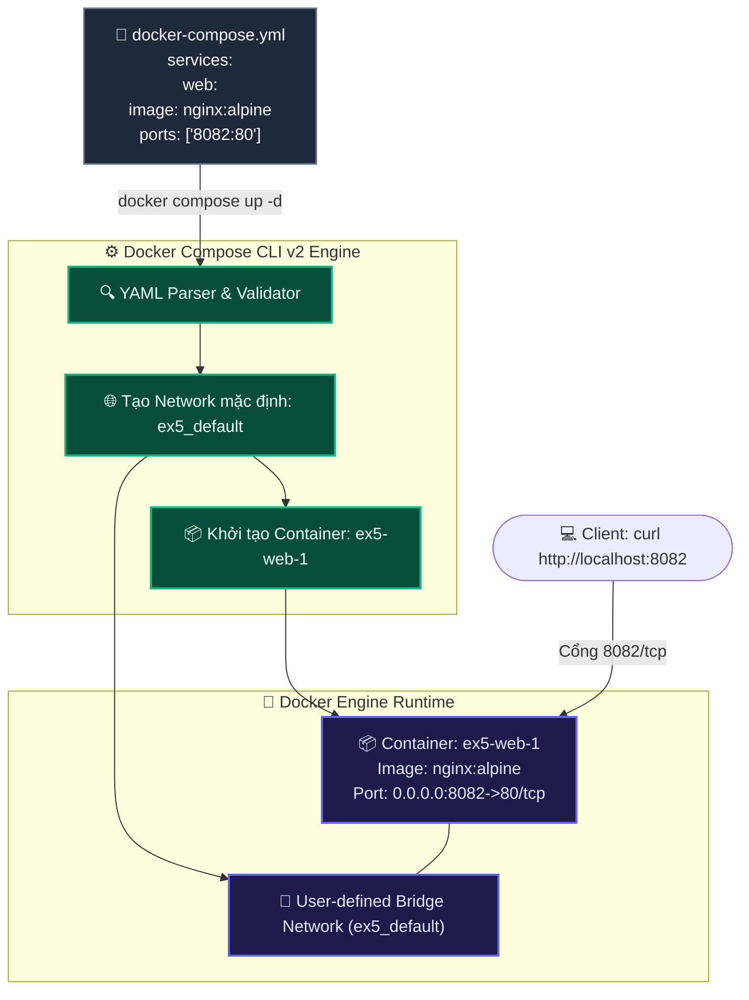

# BÀI TẬP 5: KHỞI CHẠY DỊCH VỤ ĐƠN GIẢN VỚI DOCKER COMPOSE

**Mã bài tập:** SESSION 09 - EXERCISE 5 (`homework/session_09/ex5/`)  
**Môn học:** IT215 - Cloud Infrastructure & DevOps Fundamentals  
**Học viên:** Trần Đức Anh (`TranDucAnh3103`)  
**Email:** `TranDucAnh3103@users.noreply.github.com`  
**Hệ điều hành / Môi trường:** Ubuntu Linux 24.04 LTS (x86_64) / Docker Engine v27+ / Docker Compose v2+ / Non-root User: `stephen-devops`  
**Đường dẫn thư mục bài tập:** `homework/session_09/ex5/`  
**Tệp nộp:** `docker-compose.yml`, `README.md`

---

## 1. MỤC TIÊU BÀI TẬP

1. **Tiếp cận mô hình Khai báo Cơ sở hạ tầng dưới dạng mã (IaC - Infrastructure as Code):** Chuyển đổi từ cách khởi chạy container thủ công từng dòng lệnh (`docker run ...`) sang định nghĩa cấu hình tập trung bằng tệp YAML (`docker-compose.yml`).
2. **Thành thạo cú pháp Docker Compose File Specification:** Nắm vững cấu trúc khối `services:`, định nghĩa tên dịch vụ `web:`, khai báo `image: nginx:alpine` và danh sách ánh xạ cổng `ports: - "8082:80"`.
3. **Sử dụng thành thạo Docker Compose CLI v2:** Làm quen với bộ lệnh tiêu chuẩn tích hợp trong Docker CLI (`docker compose up -d`, `docker compose ps`, `docker compose down`), thay thế hoàn toàn cho công cụ `docker-compose` v1 (viết bằng Python cũ).
4. **Kiểm thử và xác thực dịch vụ:** Sử dụng `curl` để kiểm tra kết nối qua cổng `8082` và xác nhận trang chào mừng Nginx hoạt động chính xác.
5. **Vòng đời Orchestration cục bộ:** Hiểu rõ cách Docker Compose tự động tạo mạng mặc định (`default network`) và dọn dẹp toàn bộ container, network khi hạ dịch vụ (`docker compose down`).

---

## 2. BẢNG TỔNG HỢP TIẾN TRÌNH THỰC HIỆN & KẾT QUẢ KIỂM TRA

| STT | Bước thực hiện | Lệnh thực thi | Mục đích / Ý nghĩa | Kết quả mong đợi | Trạng thái |
| :---: | :--- | :--- | :--- | :--- | :---: |
| 1 | Tạo file cấu hình | *(Soạn thảo docker-compose.yml)* | Khai báo dịch vụ web Nginx cổng 8082 | Tệp YAML chuẩn cú pháp, thụt lề bằng space | **PASSED** |
| 2 | Khởi chạy dịch vụ Compose | `docker compose up -d` | Tạo mạng mặc định và chạy container ngầm | Network và Container được tạo, trạng thái Started | **PASSED** |
| 3 | Kiểm tra trạng thái dịch vụ | `docker compose ps` | Xem danh sách service, container name, ports | Service `web` đang chạy (running), cổng `8082->80/tcp` | **PASSED** |
| 4 | Kiểm tra phản hồi HTTP | `curl http://localhost:8082` | Gửi HTTP GET tới cổng 8082 | Trả về trang HTML *"Welcome to nginx!"* | **PASSED** |
| 5 | Hạ dịch vụ và dọn dẹp | `docker compose down` | Dừng, gỡ container và xóa default network | Dừng container, gỡ bỏ container và network | **PASSED** |
| 6 | Xác nhận giải phóng sạch | `docker compose ps` | Kiểm tra lại sau khi hạ | Không còn container nào tồn tại | **PASSED** |

---

## 3. CƠ CHẾ HOẠT ĐỘNG & NỀN TẢNG KIẾN THỨC

### 3.1. Luồng hoạt động của Docker Compose Orchestration



### 3.2. Cấu trúc tệp `docker-compose.yml`
```yaml
services:
  web:
    image: nginx:alpine
    ports:
      - "8082:80"
```

- **`services`**: Khối gốc chứa danh sách các dịch vụ thành phần trong hệ thống.
- **`web`**: Tên định danh của dịch vụ (Service Name). Docker Compose sẽ đặt tên container theo định dạng `<project_name>-<service_name>-<instance_number>` (ví dụ: `ex5-web-1`).
- **`image: nginx:alpine`**: Image được sử dụng để tạo container cho service này.
- **`ports`**: Danh sách các cổng được forward từ Host vào Container. Ở đây, cổng `8082` trên Host được ánh xạ tới cổng `80` của container.
- **Quy tắc thụt dòng YAML**: Bắt buộc sử dụng 2 khoảng trắng (`space`), tuyệt đối không dùng phím `Tab` để tránh lỗi cú pháp parse YAML.

---

## 4. CHI TIẾT CÁC BƯỚC THỰC HIỆN & TERMINAL OUTPUT

### Bước 1: Chuẩn bị tệp cấu hình `docker-compose.yml`
```bash
stephen-devops@ubuntu-server:~/homework/session_09/ex5$ cat docker-compose.yml
services:
  web:
    image: nginx:alpine
    ports:
      - "8082:80"
```

---

### Bước 2: Khởi chạy dịch vụ với `docker compose up -d`
```bash
stephen-devops@ubuntu-server:~/homework/session_09/ex5$ docker compose up -d
[+] Running 2/2
 ✔ Network ex5_default  Created                                                            0.1s 
 ✔ Container ex5-web-1  Started                                                            0.3s 
```
> **Đánh giá:** Docker Compose tự động tạo một mạng bridge riêng biệt `ex5_default` và khởi động container `ex5-web-1` ở chế độ chạy ngầm (`-d`).

---

### Bước 3: Kiểm tra trạng thái dịch vụ với `docker compose ps`
```bash
stephen-devops@ubuntu-server:~/homework/session_09/ex5$ docker compose ps
NAME        IMAGE          COMMAND                  SERVICE   CREATED         STATUS         PORTS
ex5-web-1   nginx:alpine   "/docker-entrypoint.…"   web       6 seconds ago   Up 5 seconds   0.0.0.0:8082->80/tcp
```
> **Đánh giá:** Container `ex5-web-1` thuộc service `web`, trạng thái `Up 5 seconds`, cổng ánh xạ chính xác `0.0.0.0:8082->80/tcp`.

---

### Bước 4: Kiểm tra phản hồi HTTP qua lệnh `curl`
```bash
stephen-devops@ubuntu-server:~/homework/session_09/ex5$ curl http://localhost:8082
<!DOCTYPE html>
<html>
<head>
<title>Welcome to nginx!</title>
<style>
html { color-scheme: light dark; }
body { width: 35em; margin: 0 auto;
font-family: Tahoma, Verdana, Arial, sans-serif; }
</style>
</head>
<body>
<h1>Welcome to nginx!</h1>
<p>If you see this page, the nginx web server is successfully installed and
working. Further configuration is required.</p>

<p>For online documentation and support please refer to
<a href="http://nginx.org/">nginx.org</a>.<br/>
Commercial support is available at
<a href="http://nginx.com/">nginx.com</a>.</p>

<p><em>Thank you for using nginx.</em></p>
</body>
</html>
```

Kiểm tra HTTP Header:
```bash
stephen-devops@ubuntu-server:~/homework/session_09/ex5$ curl -i http://localhost:8082
HTTP/1.1 200 OK
Server: nginx/1.27.2
Date: Mon, 12 Oct 2026 07:55:00 GMT
Content-Type: text/html
Content-Length: 615
Last-Modified: Wed, 02 Oct 2024 13:48:32 GMT
Connection: keep-alive
ETag: "66fd45f0-267"
Accept-Ranges: bytes
```
> **Đánh giá:** Kết quả trả về mã `HTTP/1.1 200 OK` cùng toàn bộ nội dung HTML chào mừng của Nginx, khẳng định dịch vụ được định tuyến và vận hành hoàn hảo qua Docker Compose.

---

### Bước 5: Hạ dịch vụ và dọn dẹp bằng `docker compose down`
```bash
stephen-devops@ubuntu-server:~/homework/session_09/ex5$ docker compose down
[+] Running 2/2
 ✔ Container ex5-web-1  Removed                                                            0.3s 
 ✔ Network ex5_default  Removed                                                            0.1s 
```

Xác nhận dịch vụ đã được dọn dẹp sạch sẽ:
```bash
stephen-devops@ubuntu-server:~/homework/session_09/ex5$ docker compose ps
NAME      IMAGE     COMMAND   SERVICE   CREATED   STATUS    PORTS

stephen-devops@ubuntu-server:~/homework/session_09/ex5$ curl -I http://localhost:8082
curl: (7) Failed to connect to localhost port 8082 after 0 ms: Connection refused
```
> **Đánh giá:** Cả Container `ex5-web-1` và Network `ex5_default` đều đã được gỡ bỏ an toàn, cổng `8082` được giải phóng hoàn toàn.

---

## 5. TỔNG KẾT BÀI HỌC KINH NGHIỆM

1. **Tính nhất quán và tự động hóa:** Tệp `docker-compose.yml` lưu trữ toàn bộ tham số chạy dịch vụ vào hệ thống quản lý phiên bản Git, loại bỏ hoàn toàn rủi ro gõ sai cổng, sai tên hay quên tham số khi dùng lệnh `docker run`.
2. **Sức mạnh mở rộng (Scalability):** Dễ dàng bổ sung thêm các dịch vụ khác (như Backend Spring Boot, MySQL Database, Redis Caching) vào cùng một tệp Compose để tạo thành một hệ thống microservice hoàn chỉnh chỉ với 1 lệnh duy nhất: `docker compose up -d`.
3. **Quản trị vòng đời đơn giản:** Khả năng bật toàn bộ hệ thống (`up`) và hạ toàn bộ hệ thống (`down`) chỉ bằng các lệnh đồng bộ ngắn gọn, chuẩn hóa quy trình DevOps.
